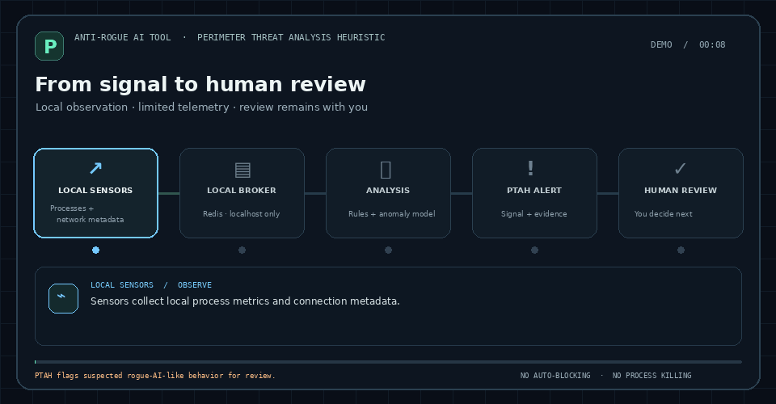

# PTAH — ANTI-ROGUE AI TOOL

**PTAH** stands for **Perimeter Threat Analysis Heuristic**.

> PTAH is an experimental, passive-monitoring prototype. It can help flag behavior for manual review, but it does not prove that activity is caused by rogue AI, block traffic, or stop processes.

PTAH observes local process resource use and IP packet metadata, joins packets to processes through a cached operating-system socket table, aggregates five-second windows, and emits review signals. It does not block traffic, change firewall rules, terminate processes, or execute a recommended response.

This is a learning prototype, not a production endpoint-security product. Model scores and rules are investigation leads, not proof of malicious activity.

## Animated overview



*Illustrative animation using synthetic data; it does not show a live detection.*

The default orchestrator starts the PyTorch autoencoder. `analyzer/ml_engine.py` is a separate Isolation Forest experiment and is not started by the orchestrator.

## Requirements

- Linux, Python 3.11–3.14, Docker Engine with the Compose plugin
- A working Docker daemon
- Packet-capture permission for the network sensor (`sudo`); other PTAH components run as the normal user
- The selected network interface must be visible to Scapy. By default PTAH uses Scapy's detected interface. Set `PTAH_INTERFACE` to override it.

## Install

From this directory:

```bash
python -m venv venv
venv/bin/python -m pip install --upgrade pip
venv/bin/python -m pip install -r requirements.txt
```

Start PTAH with `./ptah`. If you have created a personal Fish shortcut named `ptah`, that also works; the repository-local `./ptah` launcher is available to every clone.

For GPU acceleration, install a PyTorch build compatible with the installed NVIDIA driver and CUDA runtime. A CPU build also works. PTAH uses CUDA only when PyTorch reports it available.

## Run and stop

```bash
./ptah
```

PTAH asks for sudo authentication to start only the packet-capture sensor. The process sensor, broker client, and analysis engines run as your normal user. The privileged child receives only the optional `PTAH_INTERFACE` setting from the user's environment. Press `Ctrl+C` in this terminal to stop the PTAH components it started. Unrelated Python processes are left alone; the Redis data volume is preserved.

The original terminal stays active. New model and behavioral alerts are printed there with the process, signal, PID, and attribution confidence. On a graphical KDE session, PTAH also sends a critical desktop notification and opens a separate Konsole window with the alert evidence and manual review choices. In that window, `A` records approval for manual follow-up, `D` records dismissal, and Enter leaves the alert pending. Recording a decision never blocks traffic or stops a process. The popup is limited to three new windows per minute; every alert is still printed in the original terminal. Set `PTAH_ALERT_WINDOWS=0` to disable the extra Konsole windows while keeping terminal alerts and desktop notifications.

Notifications require an active desktop session and `notify-send`; detail windows require Konsole. KDE notification and focus-stealing settings may delay, hide, or decline to focus a new window, so PTAH cannot guarantee that an alert will appear above every full-screen application. If those desktop tools are unavailable, the original terminal still shows the alert details.

To preview the notification and detail window without running PTAH or creating a real alert, run:

```bash
venv/bin/python ptah_demo_alert.py
```

The demo uses clearly labeled synthetic data. It does not start sensors, connect to Redis, record an alert or decision, or change system settings. Close the demo window by pressing Enter.

## Train the local baseline

The autoencoder trains itself during the first run; there is no separate training command or dataset file to prepare. It learns a short baseline from eligible process-and-network windows produced while PTAH is monitoring. Use the computer normally during this period, with the kinds of applications and network activity you expect PTAH to see. Avoid treating an unusual or compromised session as the normal baseline.

1. Start PTAH from the project directory with `./ptah` (or use `venv/bin/python ptah_orchestrator.py`). Keep it running; it continues monitoring after training completes.
2. In a second terminal, open the project directory and run:

   ```bash
   venv/bin/python ptah_status.py
   ```

3. Look at the `deep_engine` row. `sample_count` is the number of eligible baseline windows collected; the default `train_threshold` is 500. Training begins once the count reaches that threshold. When `state=model_ready` and `model_ready=True`, the current run has finished training.
4. Leave PTAH running for continued observation. Stop it with `Ctrl+C` when you are done.

Each window covers five seconds, so 500 windows is a **minimum estimate of about 42 minutes** if one eligible process group is produced in every window. Real training may take much longer or wait indefinitely: empty, unattributed, low-confidence, stale-metric, or otherwise ineligible windows do not count. If status says `waiting_for_process_traffic`, PTAH is running but has not received eligible traffic for training. Check that both sensors are healthy and that ordinary network activity is occurring; do not loosen attribution checks just to increase the count.

The trained weights and normalization values currently live **only in memory**. They are lost when PTAH stops, so a later run gathers a new baseline and trains again. Redis retains bounded telemetry and alerts, but it does not persist the trained model. The threshold learned from this short baseline is experimental: a model-ready state means training completed, not that detection quality has been proven. Review signals manually and expect false positives or missed behavior.

For a short local smoke run, reduce the threshold to 30. This checks that the collection and training path can complete; it is **not a suitable baseline for meaningful monitoring**:

```bash
PTAH_TRAIN_THRESHOLD=30 venv/bin/python ptah_orchestrator.py
```

Packet capture can be disabled with `PTAH_CAPTURE=0`. In that mode, network-based features and rules are unavailable; it is useful for checking that the process and broker components start.

## Optional status and alert review

The alert window records decisions directly. These commands remain available if you want to review status or older alerts from a second terminal. They connect only to the local Redis service.

```bash
venv/bin/python ptah_status.py
venv/bin/python ptah_review.py list
```

`ptah_status.py` shows component heartbeats, socket-map size, attributed traffic, model readiness, the sample count, and bounded stream sizes without printing the live log stream. Status older than 15 seconds is marked stale. Redis stream lengths can include data preserved from an earlier run; they are not model-progress counters.

Signals require manual review. Record a human decision with the alert stream and Redis stream ID shown by `ptah_review.py list`:

```bash
venv/bin/python ptah_review.py decide \
  --stream alerts:behavioral \
  --id 1712345678901-0 \
  --decision approve \
  --note "Reviewed locally; investigate the process manually"
```

`approve` records that a person approved the recommendation for manual follow-up. It does not execute a response. `dismiss` records a dismissal. Both decisions are append-only entries in `alerts:decisions`.

## Observation mode and signals

`PTAH_MODE` defaults to `observe`. It is the only supported mode; other values fail closed at startup. There is no active enforcement mode.

The behavior rules operate on five-second process windows. Defaults can be adjusted with:

- `PTAH_RULE_BYTES_PER_WINDOW` — 25,000,000 payload bytes
- `PTAH_RULE_PACKETS_PER_WINDOW` — 5,000 packets
- `PTAH_RULE_REMOTE_PORTS_PER_WINDOW` — 24 remote ports
- `PTAH_RULE_ENTROPY_THRESHOLD` — 7.5 bits per byte
- `PTAH_RULE_ENTROPY_BYTES_PER_WINDOW` — 1,000,000 bytes

High entropy alone does not raise an alert because ordinary encrypted and compressed traffic is also high entropy. Repeated rule alerts for the same process are rate-limited to one per five minutes. Signals are written to `alerts:behavioral`; model signals are written to `alerts:anomalies`. Both include a manual-review state and a recommendation, and neither stream triggers a response.

## Attribution and privacy limits

- Exact established TCP or connected-UDP tuples can be attributed to a PID with high confidence when the socket is present in the cached OS socket table.
- UDP local-socket matches and TCP listener matches are marked low confidence. Ambiguous or missing matches remain `UNATTRIBUTED_NETWORK_TRAFFIC`; PTAH does not guess based on CPU use.
- Process CPU and memory values are joined by PID and process start time, and are marked unavailable if the matching process sample is stale.
- The network sensor computes payload length and entropy in memory, then stores only metadata and aggregate flow/window statistics. It does not persist packet contents.
- Redis retains bounded telemetry and alert streams in a Docker volume across runs. These records can include process names, PIDs, IP addresses, and ports. Keep Redis bound to loopback and treat the volume as private system data.
- Packet drops can occur if more than 4,096 unique flows arrive in one one-second capture window. The sensor reports this cap.
- Process telemetry runs without root and may not include details for protected processes. Network socket visibility depends on Linux permissions and the selected interface.
- Anomaly thresholds are learned from a short local baseline. They may produce false positives or miss behavior; validate alerts manually.

## Local broker hardening

Redis is bound to loopback only. The container drops Linux capabilities, disallows privilege escalation, and has process and memory limits. Its data volume is intentionally preserved across runs. Compose pins the Redis Stack server to `redis/redis-stack-server:7.4.0-v7`; review upstream security releases before upgrading this pinned version.

## Safe validation

Unit validation uses synthetic packet/socket records and pure feature/rule functions. It does not open a capture socket, alter firewall settings, stop processes, or require Docker:

```bash
venv/bin/python -m unittest discover -s tests -v
```

GitHub Actions runs this synthetic unit suite and Python syntax compilation on Python 3.11–3.14. These checks do not require Docker, packet-capture privileges, or a live desktop session; they do not replace an end-to-end test on a Linux host.

## Project policies

- [Security policy](SECURITY.md)
- [Contributing guide](CONTRIBUTING.md)
- [MIT License](LICENSE)
